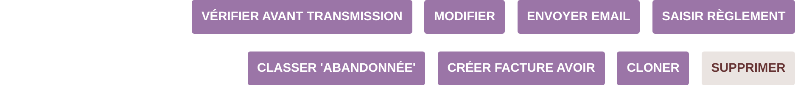
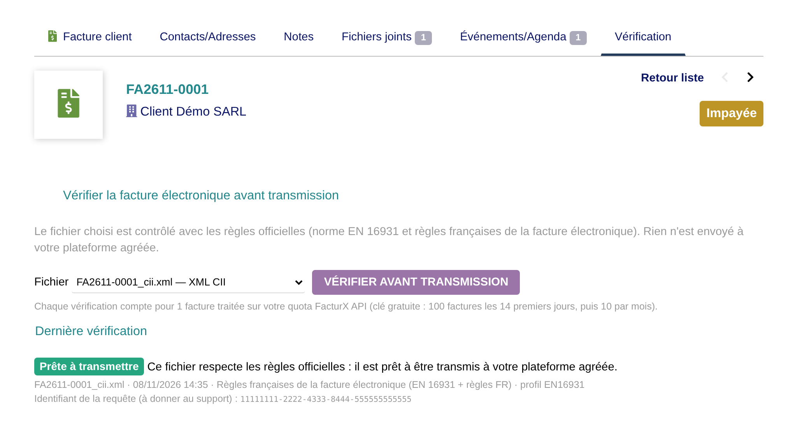
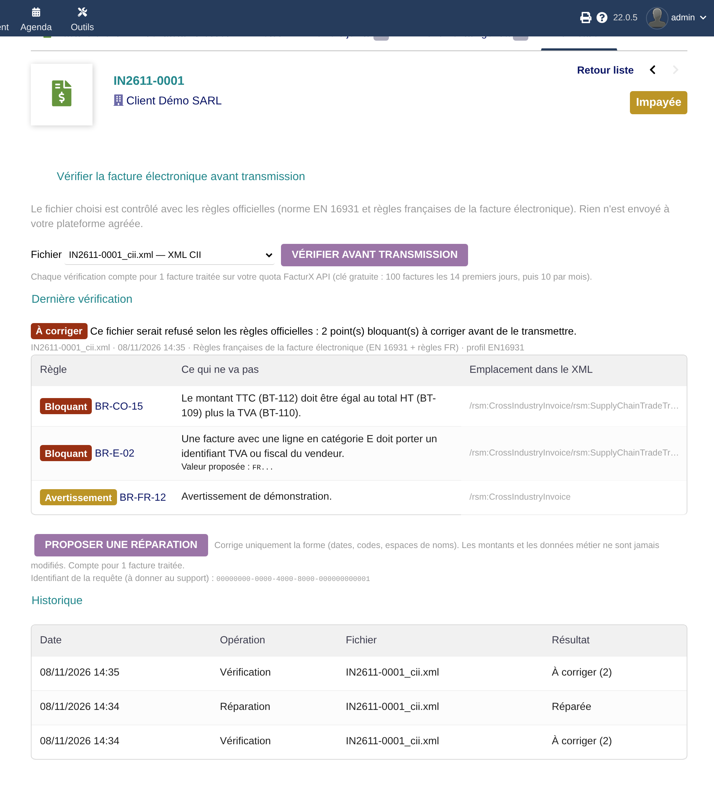
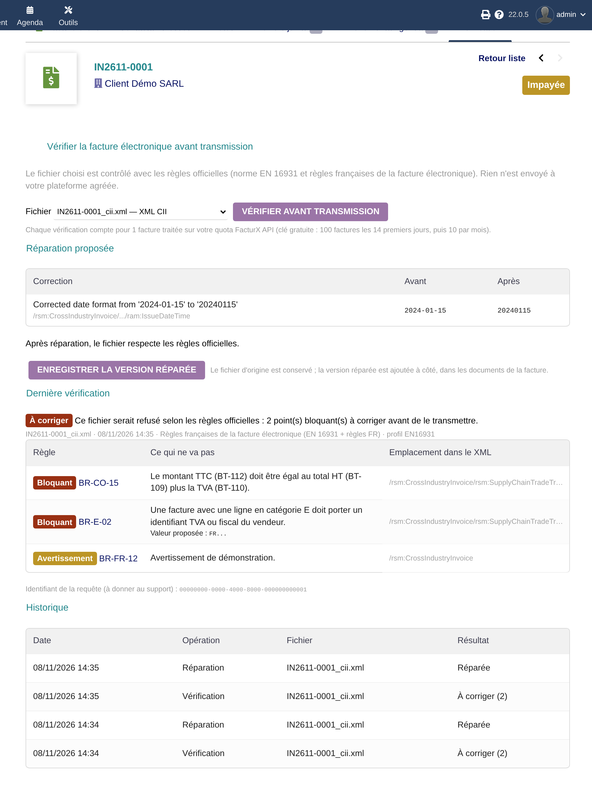
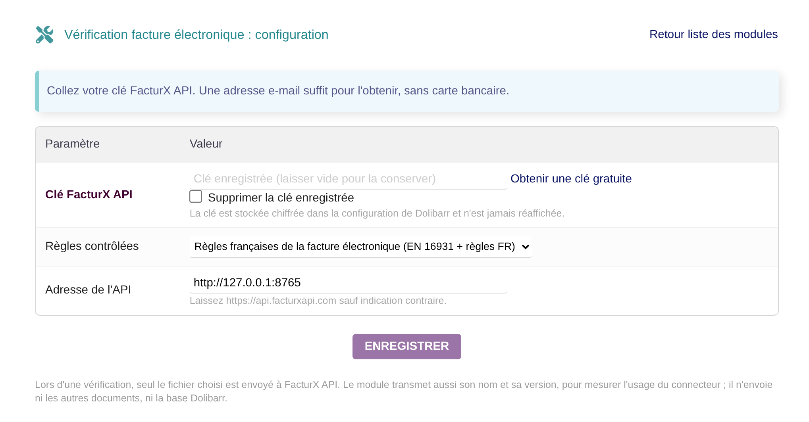
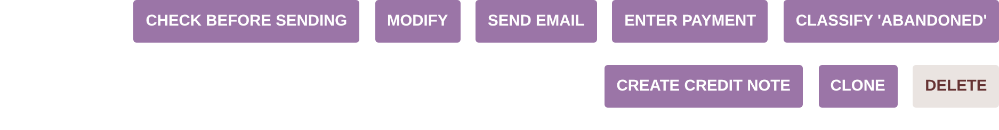
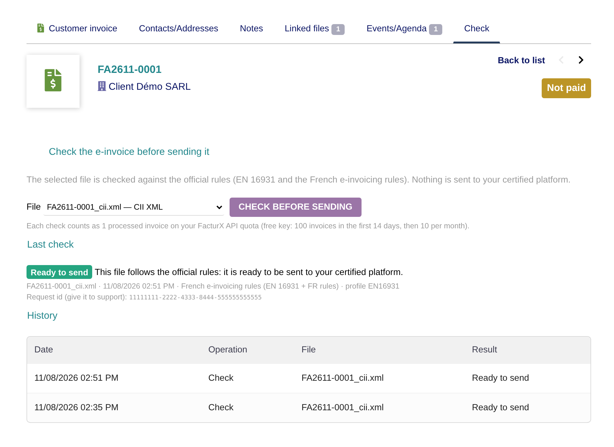
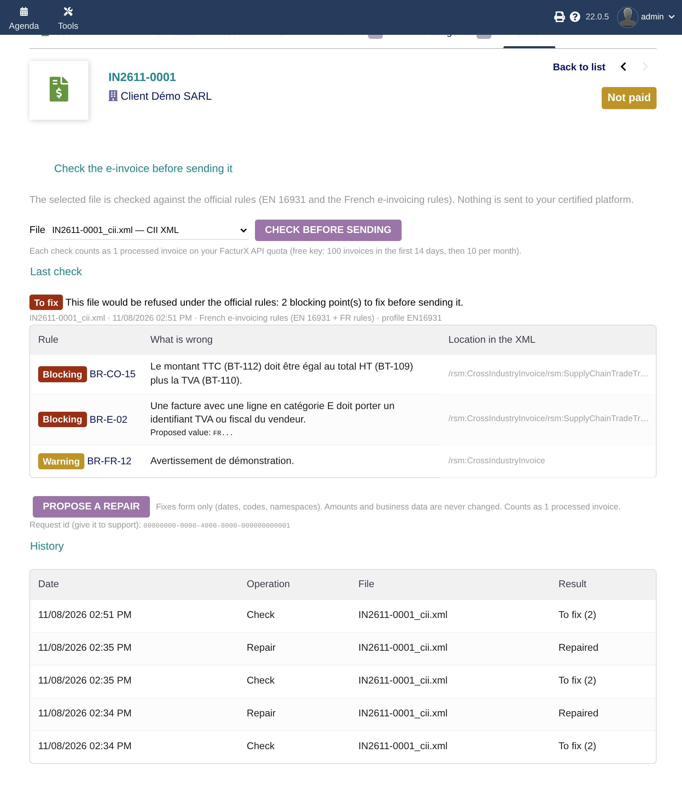
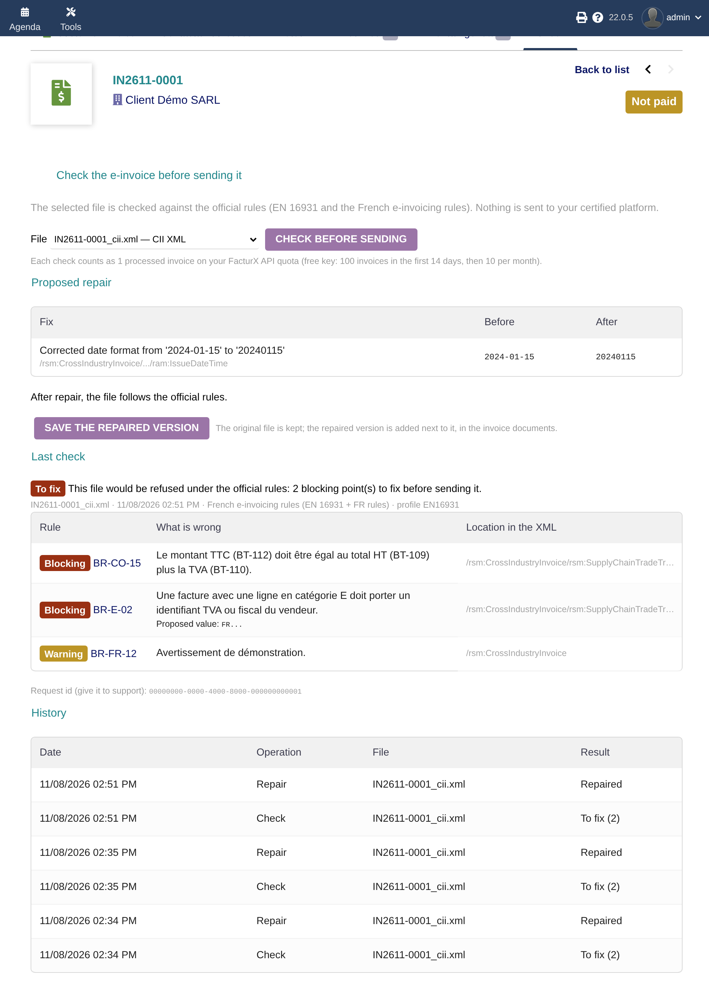

# Vérification facture électronique pour Dolibarr

[English below](#e-invoice-check-for-dolibarr)

Un bouton **« Vérifier avant transmission »** sur la fiche facture client de Dolibarr. Il contrôle le fichier de facture
électronique déjà produit par votre module (module officiel e-invoicing, Factur-X, CII…) avec les **règles officielles** :
la norme EN 16931 et les règles françaises de la facture électronique. Il liste ce qui bloquerait le fichier et peut
proposer une réparation.

Le module **ne génère pas** et **n'envoie pas** de factures : il ne remplace pas votre module de facture électronique ni
votre plateforme agréée. Il répond à une seule question avant l'envoi : *ce fichier respecte-t-il les règles ?*



| Fichier conforme | Points bloquants | Réparation proposée |
|---|---|---|
|  |  |  |

<sub>Captures prises sur Dolibarr 22.0.5 avec la doublure de test de l'API (`tests/mock-api`) : les règles et les messages
affichés sont des exemples de démonstration, pas le résultat d'un vrai contrôle.</sub>

## Ce que fait le module

- **Trouve le fichier** dans les documents de la facture : le `<REF>_cii.xml` du module officiel, un PDF Factur-X (XML
  intégré), un XML CII ou UBL. Si plusieurs fichiers existent, vous choisissez.
- **Le contrôle** avec FacturX API (`POST /api/v1/validate`, règles françaises de la facture électronique par défaut,
  ou EN 16931 seule).
- **Affiche le verdict** : *Prête à transmettre*, *À corriger* (avec chaque règle en cause, son message et
  l'emplacement dans le XML), ou *Vérification incomplète* quand toutes les règles demandées n'ont pas pu être
  contrôlées. Ce dernier cas n'est jamais présenté comme conforme.
- **Propose une réparation** pour un XML CII (`POST /api/v1/repair`). Elle porte sur la forme : dates, codes, espaces de
  noms. Les montants et les données métier ne sont jamais modifiés. Le diff s'affiche d'abord, et la version réparée est
  **ajoutée à côté** de l'original, qui n'est jamais écrasé.
- **Garde l'historique** des contrôles sur la facture : date, fichier, verdict, identifiant de requête pour le support.

## Installation

1. Téléchargez `module_facturxverify-<version>.zip` depuis les
   [Releases](https://github.com/facturxapi/dolibarr-verifier/releases).
2. Dolibarr : **Accueil › Configuration › Modules › Déployer un module externe**, puis envoyez le zip.
   Sinon, décompressez-le dans `htdocs/custom/`.
3. Activez **Vérification facture électronique (FacturX API)** dans la liste des modules.
4. Ouvrez sa configuration et collez votre clé :
   [obtenir une clé gratuite](https://facturxapi.com/api-key?source=dolibarr&utm_source=dolibarr&utm_medium=github&utm_campaign=connectors-b)
   (une adresse e-mail suffit, sans carte bancaire).
5. Donnez les droits *Lire les vérifications* et *Lancer une vérification* aux utilisateurs concernés.



Compatibilité : Dolibarr 18 à 24, PHP 7.4 ou plus récent, extension cURL.

## Quota et données envoyées

- Chaque vérification ou réparation compte pour **1 facture traitée** sur votre quota FacturX API. La clé gratuite
  donne 100 factures les 14 premiers jours, puis 10 par mois (détails sur [facturxapi.com/api-key](https://facturxapi.com/api-key)).
- Seul le fichier choisi est envoyé. Le module ajoute son nom et sa version (`User-Agent: facturx-dolibarr/<version>`,
  `X-FacturX-Client: dolibarr/<version>`) pour mesurer l'usage du connecteur. Il n'envoie ni vos autres documents, ni
  votre base Dolibarr.
- La clé est stockée chiffrée dans la configuration de Dolibarr (`dolEncrypt`) et n'est jamais réaffichée.

## Tests

```bash
php tests/unit/run.php                                    # sans Dolibarr ni réseau
MYSQL_ROOT="mysql -uroot" DOLI_VERSION=24.0.2 dev/ci.sh   # Dolibarr réel + doublure de l'API, comme la CI
```

`dev/ci.sh` installe un vrai Dolibarr (tag Git choisi) sur le serveur PHP intégré et MySQL ou MariaDB. Il active le
module, crée une facture validée, puis rejoue le parcours complet (bouton, contrôle, affichage, réparation,
enregistrement) à travers les pages de Dolibarr, face à `tests/mock-api`. La CI le lance sur Dolibarr 18, 20, 22 et 24.
`docker-compose.yml` lance l'image officielle Dolibarr avec le module monté, pour l'essayer à la main (la CI ne l'utilise pas).

## Licence

GPL-3.0-or-later, comme Dolibarr. © 2026 FacturX API.

---

# E-invoice check for Dolibarr

A **"Check before sending"** button on Dolibarr's customer invoice card. It checks the e-invoice file your e-invoicing
module already produced (official e-invoicing module, Factur-X, CII…) against the **official rules**: EN 16931 and the
French e-invoicing rules. It lists what would block the file and can propose a repair.

The module **neither generates nor sends** invoices: it replaces neither your e-invoicing module nor your certified
platform. It answers one question before sending: *does this file follow the rules?*



| Ready | Blocking points | Proposed repair |
|---|---|---|
|  |  |  |

<sub>Screenshots taken on Dolibarr 22.0.5 against the API test double (`tests/mock-api`): the rules and messages shown
are demonstration samples, not the result of a real check.</sub>

## What it does

- **Finds the file** in the invoice documents: the official module's `<REF>_cii.xml`, a Factur-X PDF (embedded XML), a
  CII or UBL XML. If there are several, you pick one.
- **Checks it** with FacturX API (`POST /api/v1/validate`, French e-invoicing rules by default, or EN 16931 only).
- **Shows the verdict**: *Ready to send*, *To fix* (each failing rule with its message and its location in the XML), or
  *Incomplete check* when not all the requested rules could be evaluated. That last case is never shown as compliant.
- **Proposes a repair** for a CII XML (`POST /api/v1/repair`). It fixes form only: dates, codes, namespaces. Amounts and
  business data are never changed. The diff is shown first, and the repaired version is **added next to** the original,
  which is never overwritten.
- **Keeps the history** of checks on the invoice: date, file, verdict, request id for support.

## Install

1. Download `module_facturxverify-<version>.zip` from
   [Releases](https://github.com/facturxapi/dolibarr-verifier/releases).
2. Dolibarr: **Home › Setup › Modules › Deploy an external module**, then upload the zip. Or unzip it into
   `htdocs/custom/`.
3. Enable **E-invoice check (FacturX API)** in the module list.
4. Open its setup and paste your key:
   [get a free key](https://facturxapi.com/api-key?source=dolibarr&utm_source=dolibarr&utm_medium=github&utm_campaign=connectors-b)
   (an email address is enough, no credit card).
5. Grant *Read checks* and *Run a check* to the users who need them.

Compatibility: Dolibarr 18 to 24, PHP 7.4 or later, cURL extension.

## Quota and data sent

- Each check or repair counts as **1 processed invoice** on your FacturX API quota. The free key includes 100 invoices
  in the first 14 days, then 10 per month (details at [facturxapi.com/api-key](https://facturxapi.com/api-key)).
- Only the selected file is sent. The module adds its name and version (`User-Agent: facturx-dolibarr/<version>`,
  `X-FacturX-Client: dolibarr/<version>`) to measure the connector's usage. It sends neither your other documents nor
  your Dolibarr database.
- The key is stored encrypted in the Dolibarr configuration (`dolEncrypt`) and never displayed again.

## Tests

```bash
php tests/unit/run.php                                    # no Dolibarr, no network
MYSQL_ROOT="mysql -uroot" DOLI_VERSION=24.0.2 dev/ci.sh   # real Dolibarr + API test double, as CI does
```

## License

GPL-3.0-or-later, like Dolibarr. © 2026 FacturX API.
